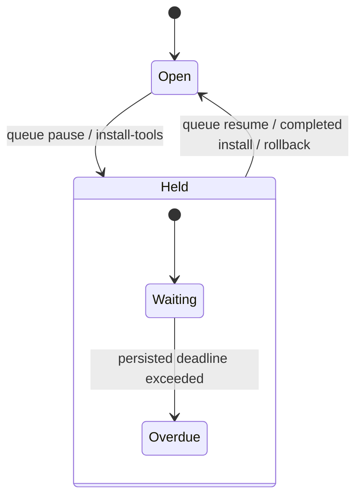
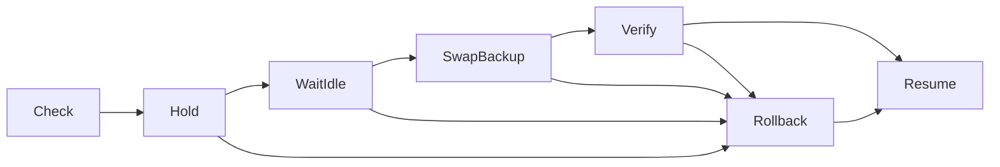

# Host policy and telemetry

A host policy is a JSON document defining build admission and supervision limits.

## Architecture

The store owns durable requests, transition history, policy audit hashes and host
admission mode. The scheduler grants leases; workers and watchdogs retain process
ownership until verified exit. OS locks coordinate writers and elections; they
are not a substitute for persisted state.





Rules:

1. Held blocks grants and new supervisor launches. Requests retain identity,
   enqueue sequence and age; running work continues. `queue pause
   --alert-after-ms 900000` persists the hold, and `queue resume` releases it.
   Repeated pause/resume in the wrong mode returns `LB_INVALID_TRANSITION`.
2. `install-tools --owner OWNER --drain --drain-timeout-ms 300000` waits at most
   the configured bound for active leases. Timeout rolls back and resumes;
   nothing is cancelled. Ordinary installs still require an empty queue.
   Ordinary preflight (npm, discovery and host measurement) runs before the hold
   and idle check. Drain takes the hold before preflight, leaving the state lock
   free for running completion. Neither path does network work during the swap.
3. Rust stage types enforce Check → Hold → WaitIdle → Swap → Verify → Resume.
   Files are backed up before replacement. A returned failure restores them
   before reopening admission. An unreadable backup fails closed with the hold
   and recovery journal retained, rather than admitting into a mixed install.
4. A crash retains Held. Explicit `queue resume` restores an uncommitted backup
   first. A durable committed journal retains the verified replacement. Hold age,
   bound and paused gauges drive `LockedBuildQueueHoldOverdue` after one minute
   beyond the configured deadline.
5. Queued supervisors acknowledge the hold, retain their lifetime lock and exec
   the successor in place. Environment, PID namespace and stdio survive. The
   installed scheduler receives the election lock and a commit token. Unsupported
   old participants refuse drain before swap; the initial rollout needs an
   ordinary empty-queue install.
6. `policy set KEY VALUE` validates the typed policy and cross-field constraints,
   including `max_bytes` requiring `target_root` and a disk reserve of at least
   100 GB. It backs up the previous bytes and atomically records the policy hash
   in `policy-ledger.json`. `check-install` reports `LB_POLICY_MODIFIED` for edits
   outside the audited command.
7. Store schema 2 declares `min_reader_version: 2`. Readers check compatibility
   before decoding request payloads and return `LB_STORE_VERSION` with upgrade
   guidance. Legacy schema 1 remains readable and is upgraded on a write.
8. Admission still enforces resource budgets and priority/FIFO rules. Recovery
   retains live or unverifiable leases; a hold never authorizes release.

Status and events carry a flat diagnostic (`code`, `message`, `limit_key`,
`limit_value`, `measured_value`, `measured_what`, `killed`) and queue trace.
The [locked-build skill](../../skills/locked-build/SKILL.md) lists the stable
error codes and metrics. `memory_needed_bytes` and `memory_free_budget_bytes`
in each status request explain memory-budget waits. Backfill can use free
budget until the head's `(maximum priority + 1) * aging_ms` reservation;
must-fix always precedes aged lower classes.

## Queue coordination

One short-lived scheduler owns `scheduler.lock` until the queue empties.
It batches admission every 250 ms and recovery every two seconds. Each worker
has a durable launch claim written before process creation and a lifetime lock.
The scheduler admits registered workers whose lifetime locks are held.
Queued workers and callers read notices, with an authoritative snapshot check
at least every two seconds. Notices and snapshots are reconstructible caches.
Status reads an atomic state/metrics snapshot without acquiring the write lock.

`locked-build wait REQUEST-ID` attaches to an accepted request. On Linux,
`locked-build recover --handoff-queued` fences and replaces legacy queued
workers in the caller's PID namespace. Running requests retain their workers.

Host-side recovery checks foreign namespace inits through readable `NSpid` fields and namespace links.
Host tasks with protected namespace links do not make this census incomplete.
An unreadable possible init preserves the lease; a provably extinct namespace produces a terminal `LB_SUPERVISION_LOST` event.

`locked-build recover --dry-run` previews foreign leases without modifying the store or generating policy, aliases or failure logs.
`recover --dry-run --release <request-id> --reason "owner confirmed ended sandbox"` previews an explicit operator release.
Omit `--dry-run` to apply that release after authorization.
Observed live worker, watchdog or command evidence refuses release, including after the hold deadline.
Release requires an expired hold or a provably dead owner worker.
The `operator_release` event records the operator UID, reason, prior stop and `LB_SUPERVISION_LOST`; release sends no signals.
During a live queue upgrade, the operator must stop legacy queued `run` callers
and reattach with `wait`; their old global polling otherwise continues.
Keep running commands and their callers alive. Other hosts require a drained
queue before replacing legacy callers. Policy-schema migrations still require
the drain enforced by `install-tools`.

Nested Cargo uses the outer lease's `LOCKED_BUILD_REAL_CARGO`, or PATH discovery,
without reading policy or state. A failed nested executable returns its own
status to the command. The outer runner owns outcome recording and cleanup.
Linux memory sampling rechecks a disappearing child's procfs state; zombies
contribute zero. An unreadable live process still fails supervision safely.

## Fields

Every policy field has a serde default; unknown fields are rejected. A small
policy can set only `host`, `capacity_units`, and `maximum_units`. `lease_accounted`
requires positive `memory_budget_bytes`, `memory_reserve_per_job_bytes` and
`memory_limit_per_job_bytes`. It reserves each request's resolved parallelism
times the reservation estimate; the separate hard limit controls enforcement.
non-Cargo commands use requested units. `memory_per_unit_bytes` and
`memory_reserve_bytes` are required only in `live_available` mode.
Relative filesystem paths resolve from the policy file's directory.
On first use, locked-build measures the host and writes a conservative policy.
Use `locked-build policy show` to print it or `locked-build policy init --force`
to regenerate it.

Measured defaults rank eligible writable local disks NVMe, SSD, HDD, using
device metadata and a small file-creation probe rather than throughput tests.
Ties prefer HOME; a secondary disk needs100GB available. Known network,
temporary, removable and read-only mounts are excluded. HOME is the fallback
when mount metadata is unavailable; on macOS an actual HOME write probe handles
APFS Data firmlinks beneath the sealed root mount. The selected base holds
`targets/` and is also `disk_path`, so admission measures the build filesystem.
Existing policies are not regenerated during installation.

`TMPDIR` is set to the effective target's `.tmp` directory, overriding an
inherited root-disk temp path. Caller targets remain authoritative and relative
targets resolve against the recorded command cwd. `.tmp` symlinks are refused.

`make install-tools ROLLOUT_OWNER=<owner>` builds and copies the locked-build executable only when it
changes, generates a measured policy on first install, installs the `cargo`
shim, and writes `~/.local/share/dev-tools/installed.json`. It places the shim
directory before `~/.local/bin` in `.profile`, `.bashrc`, and `.zshrc`.
`locked-build check-install` compares the checked-in
[`tool-versions.json`](tool-versions.json) pins with each executable. Entries
with `version` run `--version` and require the reported SemVer to meet the
minimum pin. Newer versions pass; prereleases follow SemVer ordering and build
metadata is ignored. Entries without `version` require executable presence and
are never invoked. It prints one `ok` or `mismatch` line per tool and exits 1
when a tool is missing, version output is unavailable, or its version is older.
It also prints `~/.ix/locked-build/install.json` provenance and fails on an
installed binary hash mismatch. The record contains `schema_version: u32`,
`owner: string`, `source_commit: string` (full Git SHA), `artifact_sha256: string`,
`installed_at_ms: u64` (UTC Unix milliseconds), and
`transfers: [{from: string, to: string, at_ms: u64}]`. An exclusive install lock
rejects concurrent writers; only the recorded owner may install. An explicit
`install-tools --owner <new> --transfer-from <old>` records ownership transfer.
Git builds embed HEAD and working-tree status. Verified clean source archives
require `IX_BUILD_COMMIT=<full-sha> IX_BUILD_DIRTY=false`.

| Field | Meaning |
|---|---|
| `host` | Stable host label for requests and samples. |
| `capacity_units` | Currently enabled units; zero pauses admission. |
| `maximum_units` | Largest feasible request; temporary shrink preserves queue age. |
| `max_queued_per_owner` | Positive queue cap override; absent/null uses ceil(maximum_units/4), minimum one. Running and terminal records are excluded. |
| `max_request_memory` | Positive explicit request ceiling in bytes; absent/null uses half `memory_budget_bytes`. `run --memory 16GiB` sets both reservation and hard cap without changing jobs or class defaults. Requires lease accounting and respects total budget and absolute class caps. |
| `memory_per_unit_bytes` | RAM budget charged per requested unit in `live_available` mode; optional in `lease_accounted` mode. |
| `memory_reserve_bytes` | RAM retained outside build leases in `live_available` mode; optional in `lease_accounted` mode. |
| `memory_admission` | `lease_accounted` (default) checks reservations against `memory_budget_bytes`; `live_available` checks measured available RAM. |
| `memory_budget_bytes` | Total memory available to concurrent leases in `lease_accounted` mode. |
| `memory_reserve_per_job_bytes` | Admission reservation per effective worker; default 3 GB. |
| `memory_limit_per_job_bytes` | Enforced hard cap per effective worker; default 8 GB. |
| `memory_reserve_per_job_by_class` | Optional per-class admission reservation overrides. |
| `memory_per_job_by_class` | Optional per-class per-job hard limits, bounded by the total class cap when configured. |
| `memory_cap_by_class` | Optional maximum total lease size for each named class. |
| `on_missing_cgroup` | `rss_watchdog` (default) enforces a configured cap with process-group RSS when a systemd scope is unavailable; `refuse` fails the lease without running the command. |
| `disk_reserve_bytes` | Minimum free bytes for admission. |
| `disk_path` | Directory selecting the measured filesystem. |
| `maximum_load` | New admission requires load strictly below this value. |
| `aging_ms` | Positive priority aging interval. |
| `hold_ms` | Positive running command deadline. |
| `termination_grace_ms` | SIGTERM grace before forced cleanup. |
| `sample_file` | Host-agent sample path, or null for local measurements. |
| `cargo_build_jobs` | Optional maximum Cargo jobs at one active leased unit. At spawn, divide by the total active leased units and clamp to at least one. |
| `rust_test_threads` | Optional `RUST_TEST_THREADS` value set for each leased command. |
| `cargo_incremental` | Optional incremental compilation setting; true sets `CARGO_INCREMENTAL=1`, false sets it to `0`. |
| `target_root` | Optional root for owner-specific `CARGO_TARGET_DIR` directories, used only when the caller has not set `CARGO_TARGET_DIR`. Relative paths resolve from the policy file. |
| `max_bytes` | Optional size limit for generated per-owner targets; caller-supplied `CARGO_TARGET_DIR` paths are never trimmed by lease cleanup. |
| `priority_classes` | Mapping of `must-fix`, `point`, `block`, `periodic`, `arch-test`, and `kani` to numeric priorities. The largest value sets the accepted priority limit. |
| `real_cargo` | Optional Cargo executable path used when this binary is invoked with `argv[0]` basename `cargo`. Relative paths resolve from the policy file. |

Explicit command-line `-j`/`--jobs` and `--test-threads` values, and explicit
`CARGO_BUILD_JOBS` and `RUST_TEST_THREADS` environment values, take precedence
over policy defaults. Values above the configured policy maximum are clamped;
the request report records the effective values and clamp flags. Pressure
scaling applies only when the caller leaves `CARGO_BUILD_JOBS` unset. Active
leased units include the command being started. The formula is
`max(1, floor(configured_cargo_build_jobs / active_leased_units))`; for example,
a policy value of 8 with 3 active units sets `CARGO_BUILD_JOBS=2`.
When the caller has not set `CARGO_TARGET_DIR` and target lifecycle is enabled,
each owner receives one generated directory under `target_root`. After the
owner's final active lease, cleanup removes that directory when its measured
size exceeds `max_bytes`. A caller-supplied `CARGO_TARGET_DIR` takes precedence
and is never trimmed by per-lease cleanup; worktree hygiene owns cleanup of a
worktree's `target/`. Symlink entries are skipped and never followed. Reaching
the bounded walk's entry limit marks a generated target oversized and removes
the whole directory.
`run --class NAME` looks up `NAME` in `priority_classes`; omitting class records
class `periodic` and uses its configured priority, or zero when absent. Metrics
use a `class` label with `must-fix`, `point`, `block`, `periodic`, `arch-test`,
or `kani`.

`worktree-run --repository NAME --slot N --ticket T -- COMMAND` waits for the
exclusive state-file lock for that repository slot, then submits an arch-test
job as owner `arch-test:NAME:slot-N`, class `arch-test`, and one resource unit.
Different slot numbers run concurrently. The Kani replacement is
`run --class kani -- ...`.

Scheduler commands and the PATH shim read policy from `--config`, then
`LOCKED_BUILD_CONFIG`, then `/tmp/locked-build-<uid>/policy.json`.
State resolves from `--state`, then `LOCKED_BUILD_STATE`, then
`/tmp/locked-build-<uid>`; the state directory is created mode `0700`.
Lane `IX_HOME` does not select host state or policy. Host aliases live under
`~/.ix/locked-build`; generated targets default to its `targets` directory.
Installation preserves the policy selected by existing host state, adopts the
old `~/.config/locked-build/policy.json` when applicable, and archives competing
fallback policy before migration. Policy paths and disk/target directories
are configuration metadata rather than the random store identity.

The default state path is an owned symlink to `/tmp/locked-build-<uid>`.
Writable and read-only lanes of the same user share this physical queue.
Read-only lanes access it directly when they cannot create the IX home alias.
An existing state path other than that owned alias stops resolution, preserving
its contents. The shared directory must be owned by the effective user,
mode `0700`, and a directory rather than a symlink. Unsafe fallback directories
cause an error; commands never bypass admission after a path failure.
An existing canonical policy is read without opening it for write. If absent,
generated policy is published atomically once in the shared state directory.
This keeps its canonical identity the same for writable and read-only lanes.
An unwritable target root uses `<fallback>/targets`; explicit `CARGO_TARGET_DIR`
remains authoritative. `status` includes `state_path`. `policy show` prints
effective state and policy paths to stderr, keeping stdout as policy JSON.
The persisted state file is `<state-directory>/state.json`.
The shim reads
`LOCKED_BUILD_CLASS`, `LOCKED_BUILD_OWNER`, and `LOCKED_BUILD_TICKET`, defaulting
to `point`, `cargo-shim`, and `MANUAL`. A leased command receives
`LOCKED_BUILD_LEASE=1`; when a shim invocation sees that marker, it execs
`real_cargo` directly to avoid queue recursion. This happens before state
resolution or policy initialization. Without an installed policy, the nested
shim discovers real Cargo on PATH, skipping itself. The legacy runner is
recognized by nonempty `CARGO_TARGET_DIR` and equal positive integer values
for `CARGO_BUILD_JOBS` and `RUST_TEST_THREADS`.

In `lease_accounted` mode, admission requires the sum of active leases plus
the new request to be at most `memory_budget_bytes`; requests larger than the
whole budget fail at enqueue. The systemd `MemoryMax` and RSS fallback cap equal
the computed lease size. A zero live `memory_available_bytes` value does not
block the request. Linux starts capped commands as
`systemd-run --user --scope --quiet -p MemoryMax=<cap>
-p MemorySwapMax=0 -- <command>`. On macOS, where systemd-run is unavailable,
the watchdog samples process-group RSS and kills a group that exceeds its cap.
Cap-triggered termination is counted as `rss_cap`.
The request report records whether the selected enforcement was `systemd_scope`,
`rss_watchdog`, or `refused`.

Resource observations use available RAM, available filesystem bytes, and one-minute load.
An external sample includes exactly these fields:

```json
{
  "host": "your-build-host",
  "observed_at_ms": 1795120000000,
  "memory_available_bytes": 4294967296,
  "disk_available_bytes": 85899345920,
  "load_one": 1.0
}
```

The host must match the policy; stale or future samples block admission.

Status reports measured `memory_available_bytes` in both admission modes.

Linux memory sampling uses the lease's namespace-local `/proc` and the recorded
command birth identity. A short-lived child can lose its address space while
`stat` still says running. `smaps_rollup` ESRCH means there is no address space
to charge at that instant. Empty or failed samples also recheck zombie/exited
state and kernel-proven process disappearance. An unreadable or malformed live
address space remains unavailable; it does not silently disable the cap.
Local sampling reads RAM counters without enumerating host processes.
Lease-accounted admission uses reservations and the configured budget;
low available RAM does not add a memory-pressure admission gate.
Missing measurements remain unavailable.

## Read-only sampler

`sample` reads a separate strict JSON configuration and writes Prometheus text to the
required output path. It does not open scheduler state or inspect admission/build lock
paths. Source adapters may read process metadata, `/proc/<pid>/fdinfo`, and the
declared controller registry; target-directory measurements enumerate only the
explicitly configured directories. The sampler has no timer of its own; a host timer
invokes it at the desired interval.

The sampler configuration uses `schema_version`, `host`, optional `capacity_units`,
one typed `busy_source`, and optional `target_dirs`. Target entries have `repo` and
absolute `path` fields. For example, Terra's source configuration is:

```json
{
  "schema_version": 1,
  "host": "terra",
  "capacity_units": 12,
  "busy_source": {
    "kind": "terra_wrapper_fdinfo",
    "proc_root": "/proc",
    "owner_uid": 1000,
    "wrapper_path": "/home/<user>/dev/worktrees/locked-build.sh",
    "lane_paths": [
      "/tmp/quire-heavy-check.lane1.lock", "/tmp/quire-heavy-check.lane2.lock",
      "/tmp/quire-heavy-check.lane3.lock", "/tmp/quire-heavy-check.lane4.lock",
      "/tmp/quire-heavy-check.lane5.lock", "/tmp/quire-heavy-check.lane6.lock",
      "/tmp/quire-heavy-check.lane7.lock", "/tmp/quire-heavy-check.lane8.lock",
      "/tmp/quire-heavy-check.lane9.lock", "/tmp/quire-heavy-check.lane10.lock",
      "/tmp/quire-heavy-check.lane11.lock", "/tmp/quire-heavy-check.lane12.lock"
    ]
  },
  "target_dirs": [{"repo": "dev-tools", "path": "/home/build/dev-tools/target"}]
}
```

The `lane_paths` array must contain all 12 configured ordinary lane paths. Terra
filters process directories by `owner_uid`, reads `stat` to select `bash`, and then
matches only cmdlines whose `argv[1]` equals `wrapper_path`. It reads fdinfo only after
the corresponding fd symlink target matches a configured lane path. A matching lane
counts only when fdinfo contains a `FLOCK WRITE` record, so queued wrappers with an
open but unlocked lane descriptor do not count as busy. Host source types and
capacities are constrained as follows:

| Host | Busy source | Configured capacity |
|---|---|---:|
| Draco | Distinct configured slot paths whose live `/usr/bin/lockf -t 0` process has a child | 6 |
| Terra | Distinct configured lane paths with a `FLOCK WRITE` record held by the configured wrapper process | 12 |
| Titan | Live cargo-resource-controller jobs, FLOCK lanes held by the two configured build wrappers, and arch-test FLOCK lanes, deduplicated by process group | omitted |
| Luna | Top-level `cargo` process trees running build, test, or check commands | omitted |

Titan has three observed lock-backed sources in addition to the controller registry:
the 13 lanes in `/home/<user>/dev/worktrees/locked-build.sh` (12 ordinary lanes and
the separate Kani lane), three `cargo-slot.sh` lanes under the QSL handoff worktree,
and per-repository arch-test lanes held by `/home/<user>/arch-test-run.sh`. Configure
both build wrappers explicitly in `wrapper_sources`; the validator requires both
observed wrapper basenames and their sourced lane counts. `arch_lock_prefix` is the
absolute prefix ending in `arch-test-target-`, such as
`/home/<user>/dev/worktrees/arch-test-target-`. The arch adapter reads fdinfo only
for the configured `arch-test-run.sh` process and only when an fd symlink matches a
valid repository lane path. It never opens or stats lock paths. Wrapper adapters
similarly filter to the configured Bash script before inspecting descriptors. Active
process groups are unioned across the controller registry and all lock sources, so an
inherited descriptor or a build visible through multiple sources counts once.

Titan's mixed, partially uncapped controls do not establish a host-wide configured
slot count. Omit `capacity_units`; do not derive a total from the per-repository arch
lanes or from the wrapper ceilings.

The Titan source shape is:

```json
{
  "schema_version": 1,
  "host": "titan",
  "busy_source": {
    "kind": "titan_build_wrappers_and_arch_locks",
    "proc_root": "/proc",
    "owner_uid": 1000,
    "registry_path": "/home/<user>/.local/state/cargo-resource-controller/jobs.json",
    "arch_lock_prefix": "/home/<user>/dev/worktrees/arch-test-target-",
    "arch_wrapper_path": "/home/<user>/arch-test-run.sh",
    "wrapper_sources": [
      {
        "wrapper_path": "/home/<user>/dev/worktrees/locked-build.sh",
        "lane_paths": [
          "/tmp/quire-heavy-check.lane1.lock", "/tmp/quire-heavy-check.lane2.lock",
          "/tmp/quire-heavy-check.lane3.lock", "/tmp/quire-heavy-check.lane4.lock",
          "/tmp/quire-heavy-check.lane5.lock", "/tmp/quire-heavy-check.lane6.lock",
          "/tmp/quire-heavy-check.lane7.lock", "/tmp/quire-heavy-check.lane8.lock",
          "/tmp/quire-heavy-check.lane9.lock", "/tmp/quire-heavy-check.lane10.lock",
          "/tmp/quire-heavy-check.lane11.lock", "/tmp/quire-heavy-check.lane12.lock",
          "/tmp/quire-heavy-check.lane-kani.lock"
        ]
      },
      {
        "wrapper_path": "/home/<user>/dev/worktrees/QSL-handoff/<worktree>/cargo-slot.sh",
        "lane_paths": [
          "/home/<user>/dev/worktrees/QSL-handoff/<worktree>/cargo-slots/slot1",
          "/home/<user>/dev/worktrees/QSL-handoff/<worktree>/cargo-slots/slot2",
          "/home/<user>/dev/worktrees/QSL-handoff/<worktree>/cargo-slots/slot3"
        ]
      }
    ]
  }
}
```

Replace `<user>` and `<worktree>` with the host's actual account and QSL handoff
worktree. The validator rejects a config missing either observed wrapper or any
configured lane.

The sampler emits `ix_build_slots_busy` when its busy source can be read and emits
`ix_build_slots_configured` only for Draco and Terra. Queue depth and build/test outcome
series are omitted because these sources cannot truthfully count them. Each explicitly
configured target directory produces `ix_build_target_dir_bytes{host,repo}`. If a
source cannot be read, its affected metric is omitted; `ix_build_probe_unavailable`
identifies the bounded probe name and a bounded diagnostic is written to stderr. The
sampler writes metrics from successful sources and returns success after the output
write; invalid configuration or output-write failures return an error. Process,
fdinfo, and target-directory enumeration have hard bounds;
reaching a bound makes the affected measurement unavailable. Terra's waiter ticket
files are readable, but the current queue-depth metric requires a priority label and
those tickets do not provide one; the sampler omits queue depth rather than inventing
an attribution.

## Transition events

`status` and ordinary `recover` emit a versioned JSON snapshot.
Recovery previews and explicit releases emit a `dry_run` flag and per-request `decisions` with actions and liveness evidence.
Each transition has stable store/event/request IDs, host, owner, ticket,
UTC time, resulting state, priority, units, capacity/free units, wait/hold durations, and reason.
Consumers deduplicate by event ID and retain their own history before pruning.
`pruned_events` counts removed transitions; `next_event_sequence` exposes missing history.
Durations within one boot use a monotonic clock; UTC timestamps support cross-source
correlation. Queue-wait histograms across a reboot add the pre-reboot age captured at
recovery to the monotonic wait after recovery.

Requests move from `queued` to `running`, then `succeeded`, `failed`, `timed_out`, or `cancelled`.
A queued request can become `cancelled` without running.
After supervisor loss, the authenticated watchdog continues timeout and cancellation enforcement.
The request remains suspect and occupied until command exit is verified.
Release requires a kernel process-group absence result, including after a supervisor crash.
An incomplete or empty process enumeration preserves occupancy until that independent check succeeds.
No new grant exceeds configured capacity; reduced capacity can report existing overcommit.

## Examples

List stable error codes independently from a host policy:

```sh
locked-build error-codes
locked-build error-codes state
```

Read a selected host:

```sh
locked-build --state /tmp/build-queue --config /path/to/host-policy.json status
```

## Errors

The CLI returns 2 for invalid input, unavailable state, or policy errors.
Diagnostics begin with a stable code:

| Code | Meaning |
|---|---|
| `configuration` | Invalid host policy or a missing required CLI option. |
| `io` | Filesystem, process, or operating-system operation failed. |
| `state` | Invalid, unsupported, oversized, or unsafe persisted state. |
| `request` | Unknown request or invalid requested resource bounds. |

A running command's nonzero result is preserved as its own outcome.

## Prometheus metrics

`metrics` writes Prometheus text to standard output. `metrics --output PATH` publishes a complete textfile document atomically.
Collection reads atomic state snapshots without taking the scheduler write lock. A collector timeout or unavailable store preserves previous textfile samples and sets the export-error gauge.

`install-tools` discovers the running node_exporter's textfile directory and installs metric refresh and daily prune schedules.
`prune --exported-only` removes terminal requests covered by the last successful export checkpoint, preserving cumulative counters.

See [metric semantics](monitoring/metrics.md) for the family inventory, label bounds, duration clocks, and upgrade behavior.
See [scrape build telemetry](monitoring/README.md) for host installation and monitoring configuration.

## Kache wrapper policy

Kache is selected per admitted request when its executable is present and answers `--version` successfully with a kache version.
The version subprocess has a 500 ms response deadline and a four KiB output limit. It starts outside the command-start transaction lock.
The health check does not compile, restart a daemon, or edit a kache or Cargo configuration file.

`cache.enabled` defaults to true. Set it to false to disable the wrapper on that host.
`cache.executable` optionally selects a binary relative to the policy file; otherwise discovery uses the configured telemetry executable or PATH.
A policy executable takes precedence over PATH for both wrapper selection and telemetry.
The executable is passed as an absolute `RUSTC_WRAPPER` value to the admitted command.
Disabled, missing, unhealthy, or changed-policy selections set an empty value, which also disables an inherited Cargo-config wrapper.
A skipped cache never refuses the command.

`cache.mode` defaults to local permission. Shared mode permits the already configured remote while retaining local fallback.
The input spelling both is a compatibility alias of shared; both serialize and report as shared.
Local mode preserves the caller's existing KACHE_LOCAL_ONLY=true or1 value without replacing it.
They do not provision a remote endpoint. Existing jobs, test threads, memory leases, and target-directory limits remain unchanged.
The lease record stores `cache_wrapper` and `cache_wrapper_status` beside duration and memory evidence.
Old records default to an unrecorded decision. Cache observations remain host-level; activity sessions cannot be joined reliably to individual lease IDs.

## Cache and target cleanup

Kache owns its content-addressed store and store garbage collection. Locked-build does not delete cache entries or invoke kache clean.
The build-lane owner and minder own idle target cleanup after checking processes and active leases.
Point locked-build target limits at owner target directories, never the kache store.
Use kache's target cleanup only on idle targets; avoid simultaneous target cleanup by two owners.
Store garbage collection and target deletion reclaim different references to cloned files, so their reported byte totals must not be added as physical disk savings.

## Build provenance

`--version` includes the commit and dirty state captured at compilation. `ix_build_info` carries the same commit and dirty labels.
The build reads Git metadata or accepts `IX_BUILD_COMMIT` and `IX_BUILD_DIRTY` from the build environment.
Use a full commit SHA and true/false dirty value for release builds. Unavailable or invalid commit provenance becomes unknown and dirty=true.
The installed executable performs no Git call for provenance. Version-skew detection compares compiled commit, dirty state, and package version.
